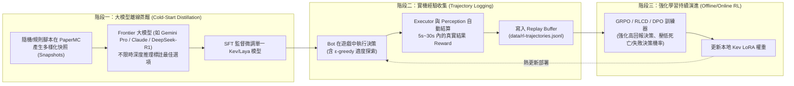
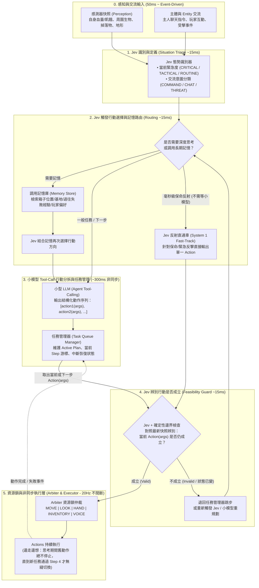

# System Design Proposal: 導入 Jev/Kev 決策模型與小模型 Tool-Call 取代行為樹之非同步架構

- **狀態**：Proposed (v2 - Cognitive Pipeline & RL Training Evolution)
- **日期**：2026-10-17
- **前置基礎**：[system-design-v1.1.md](file:///Users/james/projects/playground-mineflayer/docs/sys-design/system-design-v1.1.md)、[implement-plan-stage-2.md](file:///Users/james/projects/playground-mineflayer/docs/implement-plan-stage-2.md)、[ADR-001](file:///Users/james/projects/playground-mineflayer/docs/ADR/001-npc-control-boundaries.md)、[ADR-003](file:///Users/james/projects/playground-mineflayer/docs/ADR/003-companion-bot-layered-control.md)
- **設計核心目標**：
  1. **以「Jev/Kev + 小型 LLM Tool-Call + 任務管理器」取代硬編碼行為樹（BT）**：將決策流程轉為「感知與交流輸入 $\to$ Jev 識別定義 $\to$ Jev 行動與記憶調用路由 $\to$ 小模型 Tool-Call 任務拆解 $\to$ Jev 行動成立辨別 $\to$ 資源鎖執行」。
  2. **全非同步「邊走邊想（Continuous Execution while Thinking）」**：決策、記憶檢索、任務拆解與底層物理行動完全解耦；Bot 在思考新計畫期間維持原移動/動作不中斷，僅在新任務通過驗證並下達時才由 [`arbiter.ts`](file:///Users/james/projects/playground-mineflayer/src/execution/arbiter.ts) 平滑切換方向與資源鎖。
  3. **單一決策模型跨情境泛化與強化學習（RL）閉環**：不為每個子問題單獨訓練模型，而是以結構化狀態共享單一 Kev/Laya 模型，結合「大模型蒸餾冷啟動 + 遊戲結果自動 Reward (GRPO/RLCD)」持續進化。
  4. **漸進式替換而非打掉重練**：100% 保留現有 [`perception.ts`](file:///Users/james/projects/playground-mineflayer/src/perception.ts)、[`blackboard.ts`](file:///Users/james/projects/playground-mineflayer/src/blackboard.ts)、[`arbiter.ts`](file:///Users/james/projects/playground-mineflayer/src/execution/arbiter.ts)、[`executor.ts`](file:///Users/james/projects/playground-mineflayer/src/execution/executor.ts) 與 [`src/actions/**`](file:///Users/james/projects/playground-mineflayer/src/actions/navigation.ts)，僅以相同的 `ActionRequest[]` 介面逐步替換 [`src/bt/**`](file:///Users/james/projects/playground-mineflayer/src/bt/companion-tree.ts)。

---

## 1. 決策模型 (Jev/Kev/Laya) 如何訓練與結合強化學習 (RL)？

### 1.1 為什麼不需要收集「人類職業玩家的操作畫面」？
傳統視覺強化學習（如 OpenAI VPT）需要收集數萬小時人類玩家的螢幕錄影，是因為它必須從「像素畫面（Pixels）」學會辨識方塊與控制滑鼠。
但在本專案中，[`src/perception.ts`](file:///Users/james/projects/playground-mineflayer/src/perception.ts) 與 [`src/blackboard.ts`](file:///Users/james/projects/playground-mineflayer/src/blackboard.ts) 已經將世界完美抽象為**高語義密度的結構化 JSON 快照**（例如 `health: 8`, `threats: [{ name: 'creeper', distance: 3.2 }]`, `inventory: ...`）：
* **共享底層語義表徵**：Kev 與 Laya 的基底模型（如 Qwen 0.5B~3B）在預訓練階段已具備完整的 Minecraft 先驗知識（知道苦力怕會爆炸、骷髏是遠程、鑽石比腐肉珍貴、小麥成熟 `age === 7`）。
* **單一模型回答所有選擇題**：因為輸入格式統一為 `(SnapshotContext, Question, CandidateOptions)`，**同一顆 Kev/Laya 模型**可以同時回答「先砍哪個敵人」、「是否要逃跑」、「先撿什麼」、「該用哪個記憶」、「小模型拆解的 Action 是否成立」，**完全不需要為每個子情境個別訓練獨立模型**。

### 1.2 實戰三階段訓練管線：從「冷啟動蒸餾」到「強化學習持續進步」
直接拿未微調的開源模型上場，其機率校準（Calibration）與對本專案 [`src/actions/**`](file:///Users/james/projects/playground-mineflayer/src/actions/navigation.ts) 物理限制的理解確實不是最佳的。業界標準做法是採用 **「合成專家蒸餾 (SFT) + 強化學習決策校準 (RLCD / GRPO)」** 三階段閉環：



#### 第一階段：合成專家蒸餾（解決初期無玩家資料問題）
* 不需要真人玩，而是讓現有的 Bot 在 PaperMC 測試服自動跑各種隨機情境（刷出不同怪物組合、不同血量、不同背包物品、不同障礙物），側錄下 5,000 ~ 10,000 筆 `BlackboardSnapshot` JSON。
* 在離線批次腳本中，將這些快照餵給**大型推理模型（Teacher LLM，如 DeepSeek-R1 或 Gemini Pro）**，附上完整的遊戲規則與死傷代價，讓大模型花 5~10 秒深思熟慮選出最佳答案與排序。
* 用這批高質量合成資料對本地 Kev/Laya 進行監督微調（SFT），即可獲得達到高階玩家水準的初始決策模型。

#### 第二階段：遊戲內自動計算 Reward（零人工標註的強化學習訊號）
Minecraft 是完美的強化學習環境，因為**行動的好壞在幾秒鐘內就會由遊戲物理引擎給出客觀結果**。我們可以在 [`src/execution/executor.ts`](file:///Users/james/projects/playground-mineflayer/src/execution/executor.ts) 與 [`src/perception.ts`](file:///Users/james/projects/playground-mineflayer/src/perception.ts) 自動計算每筆決策的短期與長期回報 $R$：

| 決策類型 | 正向獎勵 (+Reward) | 負向懲罰 (-Penalty) | 自動觀測來源 |
| :--- | :--- | :--- | :--- |
| **戰術與目標選擇**（砍誰/逃跑） | 擊殺敵人 (`+5`)、成功脫離危險且未扣血 (`+3`)、保護主人未受傷 (`+4`) | 自身扣血 (`-1.5 / HP`)、主人扣血 (`-2.0 / HP`)、自身死亡 (`-50`) | `entityDead`, `health`, `death` 事件 |
| **撿拾與狩獵選擇** | 單位時間內獲得高價值物品/肉品 (`+2 ~ +10`) | 追擊超時逃脫 (`-2`)、尋路卡死進入 Cooldown (`-3`) | `executor` 結果與背包差集 |
| **Jev 行動成立辨別** | 放行的 Action 在時限內回傳 `SUCCESS` (`+2`)；成功攔截必定失敗的 Action (`+2`) | 放行的 Action 立即回傳 `FAILURE` / `FAULTED` (`-4`) | `ActionResult.status` |

#### 第三階段：結合 RLCD / GRPO 持續強化學習
* Laya 與 Kev 原生支援 **RLCD（Reinforcement Learning for Calibrated Decisions）** 與 **GRPO（Group Relative Policy Optimization）**。
* 每次 Kev 針對同一情境抽樣評估一組候選選項 $(o_1, o_2, \dots, o_k)$，根據實機執行後的真實回報 $R$ 計算相對優勢（Advantage），直接更新決策頭與 LoRA 權重：
  * 若某次在 `HP = 8` 選擇硬打苦力怕導致炸死（$R = -50$），該選項在類似狀態下的機率會被大幅壓低；
  * 若選擇先拉開吃肉再反殺成功（$R = +6$），該決策路徑的機率與信心校準就會自動提升。

---

## 2. 新一代非同步認知架構：以 `Jev + 小模型 Tool-Call` 取代行為樹

依照你的設計構想，我們將原本靜態的行為樹（[`src/bt/**`](file:///Users/james/projects/playground-mineflayer/src/bt/companion-tree.ts)）替換為一條**五階段非同步認知管線（5-Stage Asynchronous Cognitive Pipeline）**，同時在底層保留現有的資源鎖（[`arbiter.ts`](file:///Users/james/projects/playground-mineflayer/src/execution/arbiter.ts)）。

### 2.1 完整決策邏輯流程圖



### 2.2 五大階段的職責與解決的關鍵工程問題

1. **階段一：Jev 識別與定義 (`SituationIdentifier`)**
   * **輸入**：最新 `BlackboardSnapshot` + 顯著變化事件（Delta Event，如主人剛說了一句話、剛扣血、剛發現新實體、或上一個任務剛完成）。
   * **注意（防洗頻節流）**：並非每 50ms 都無腦呼叫 Jev，而是當「世界狀態發生有意義的改變（Significant State Change）」或「定時心跳（如每 500ms）」時觸發。
   * **輸出**：定義當前情境標籤（如 `UNDER_AMBUSH`, `OWNER_REQUEST`, `TASK_IDLE`, `PATH_STALLED`）與緊急程度。

2. **階段二：Jev 觸發行動選擇與記憶調用路由 (`CognitiveRouter`)**
   * **記憶按需調用（On-Demand Memory Retrieval）**：平時走路或打怪不需要把所有箱子內容、地圖座標歷史全部塞進 Context。由 Jev 先判斷 `boolean("Does this situation require querying long-term memory?")` 及 `choice("Which memory category?", ["BOX_REGISTRY", "LOCATION_LANDMARKS", "RECENT_FAILURES"])`。調出記憶後再讓 Jev 決定高階行動方針。
   * **關鍵安全設計 —— System 1 反射直通車（Fast-Track）**：
     * 如果現在苦力怕貼臉或血量見底，若還要等小模型花 400ms 生成 `retreat(args)`，Bot 會多挨一刀。
     * 因此當 Jev 在此階段選出「緊急保命單步動作（如 `Retreat` 或 `EmergencyEat`）」時，**可繞過小模型直接送入階段四驗證並搶佔資源鎖（耗時 `< 30ms`）**；同時背景若需要長線撤退規劃，再平行讓小模型思考。

3. **階段三：小模型 Tool-Call 行動分拆與任務管理 (`ToolCallPlanner` + `TaskManager`)**
   * **AI Agent Tool-Call 模式**：將現有 [`src/actions/**`](file:///Users/james/projects/playground-mineflayer/src/actions/navigation.ts) 的所有 Adapter 封裝為標準的 **Tool Schemas（工具定義）**：
     * `followMaster({ canDig, allowBridge })`
     * `moveToPosition({ x, y, z, canDig, allowBridge })`
     * `combatTarget({ entityId })`
     * `retreatFromThreats({ safeDistance })`
     * `eatFood({ urgent })`
     * `equipBestGear()`
     * `huntAnimals({ targetType, maxCount, radius, durationMs })`
     * `farmPlant({ cropType, radius })`
     * `farmHarvest({ cropType, replant })`
     * `boxDeposit({ boxId, filter })` / `boxWithdraw({ boxId, item, count })`
   * 小模型收到 Jev 定調的目標後，直接以 Tool Call 陣列形式輸出分拆後的行動序列：`[action1(args), action2(args), ...]`，存入 **任務管理器 (`TaskManager`)**。
   * **並行子任務支援**：小模型可同時輸出互不衝突的行動組合（例如 `[moveToPosition(base), eatFood()]`），因為底層資源鎖會自動讓 `MOVE+LOOK` 與 `HAND+INVENTORY` 並行執行。

4. **階段四：Jev 辨別行動是否成立 (`FeasibilityVerifier` —— 防幻覺與防狀態漂移的核心防線)**
   * **為什麼這一步至關重要？**
     因為我們是**非同步「邊走邊想」**：當小模型花 400ms 拆解出 `[combatTarget(id=42), pickupItem(id=99)]` 時，400ms 後的現在，怪物 `42` 可能已經死了，或者 Bot 血量剛掉到 3 滴，或者小模型產生了參數幻覺（例如想種背包裡沒有的種子）。
   * **雙層檢驗機制**：
     1. **硬規則快速預檢（0.1ms）**：檢查目標 Entity 是否仍存在、背包是否有該物品、參數型別是否合法。
     2. **Jev 語義成立辨別（15ms）**：對照**最新一刻的 `BlackboardSnapshot`**，詢問 Jev：`boolean(latestSnapshot, "Is executing action1(args) right now valid, safe, and aligned with current intent?")`。
     3. **結果處理**：若成立，立即轉為 `ActionRequest` 送交資源鎖；若不成立，直接中止該步驟並通知任務管理器跳步或重規劃，**絕不讓錯誤指令碰到 Mineflayer 底層**。

5. **階段五：如何實現「一邊走一邊想、腳步不會停，只有任務改變才換方向」？**
   * 現有架構的 [`Executor`](file:///Users/james/projects/playground-mineflayer/src/execution/executor.ts) 與 [`Arbiter`](file:///Users/james/projects/playground-mineflayer/src/execution/arbiter.ts) 天生就是為此設計的！
   * **運作原理**：
     * 我們在 `TaskManager` 中維持一個 **「當前生效中的行動集合 (`activeApprovedRequests: ActionRequest[]`)」**。
     * 每 100ms 的 `runner.decide()` 迴圈，不再去跑行為樹 `tree.tick()`，而是直接把 `TaskManager.getActiveRequests()` 餵給 `executor.reconcile()`。
     * **當 Jev 與小模型在背景花 500ms 思考新任務時**：`TaskManager.getActiveRequests()` 依然持續回傳**上一個正在進行的動作（例如 `NormalFollow` 或 `ComeOnce`，且保持同一個 `runId`）**。根據 `[RULE-07]`，只要 `runId` 沒變，Pathfinder 就會以 20Hz 持續流暢移動，**腳步一毫秒都不會停頓**！
     * **當新任務完成思考並通過 Jev 階段四驗證的那一瞬間**：`TaskManager` 原子替換（Atomic Swap）`activeApprovedRequests` 為新的 `action1(args)`（分配新 `runId`），並呼叫 `runner.requestUrgentTick()`。`Arbiter` 立即在 50ms Fence 內取消舊方向、無縫切換往新方向移動！

---

## 3. 核心程式碼介面設計 (`src/cognitive/`)

為了不破壞現有系統，我們將新架構封裝於 `src/cognitive/` 目錄下，並對外暴露與原本 `BehaviorTree` 完全相容的介面：

```typescript
// src/cognitive/types.ts
import type { ActionType, ResourceChannel } from '../policy.ts';

export interface ToolCallAction {
  readonly stepId: string;
  readonly actionType: ActionType;
  readonly targetId: number | null;
  readonly params: Readonly<Record<string, unknown>>;
  readonly requiredResources?: readonly ResourceChannel[];
  readonly canRunInParallelWithNext?: boolean;
}

export interface TriageResult {
  readonly urgency: 'CRITICAL_REFLEX' | 'TACTICAL' | 'ROUTINE' | 'IGNORE';
  readonly situationSummary: string;
  readonly needsMemory: boolean;
  readonly memoryQueryType?: 'BOXES' | 'LANDMARKS' | 'COMBAT_HISTORY' | null;
  readonly fastTrackAction?: ToolCallAction | null; // 緊急反射時直接由 Jev 給出，不等小模型
}

export interface VerificationResult {
  readonly isValid: boolean;
  readonly confidence: number;
  readonly rejectReason?: string;
}
```

### 3.1 與現有 `Runner` 零縫隙對接的 `CognitiveOrchestrator`

看看現有的 [`src/bt/runner.ts`](file:///Users/james/projects/playground-mineflayer/src/bt/runner.ts#L24-L32)：它只需要一個擁有 `tick(snapshot)` 與 `halt()` 方法的物件！
因此，我們的 `CognitiveOrchestrator` 可以直接當作 Drop-in Replacement 傳給 `createRunner`：

```typescript
// src/cognitive/orchestrator.ts
import type { BlackboardSnapshot } from '../blackboard.ts';
import type { ActionRequest } from '../execution/types.ts';

export function createCognitiveOrchestrator(deps: {
  jevClient: JevDecisionClient;
  smallLlmClient: SmallLlmToolClient;
  memoryStore: MemoryStore;
}) {
  // 當前已通過 Jev 階段四驗證、正在持續執行的 ActionRequest (維持相同 runId 確保走路不中斷)
  let currentActiveRequests: ActionRequest[] = [];
  let thinkingInFlight = false;

  // 背景非同步決策管線 (一邊走一邊想，完全不阻塞 10Hz physicsTick)
  async function runAsyncCognitivePipeline(triggerSnapshot: BlackboardSnapshot, triggerReason: string) {
    if (thinkingInFlight) return;
    thinkingInFlight = true;
    try {
      // [Step 1] Jev 識別與定義
      const triage = await deps.jevClient.identifySituation(triggerSnapshot, triggerReason);
      if (triage.urgency === 'IGNORE') return;

      // [Step 2] Jev 路由：若為毫秒級緊急反射，直接走 Fast-Track；若需記憶則先調用記憶
      let candidatePlan: ToolCallAction[];
      if (triage.urgency === 'CRITICAL_REFLEX' && triage.fastTrackAction) {
        candidatePlan = [triage.fastTrackAction];
      } else {
        const memoryContext = triage.needsMemory
          ? await deps.memoryStore.retrieve(triage.memoryQueryType!, triggerSnapshot)
          : null;
        const selectedDirection = memoryContext
          ? await deps.jevClient.selectWithMemory(triggerSnapshot, triage, memoryContext)
          : triage.situationSummary;

        // [Step 3] 小模型 Tool-Call 分拆動作序列 (action1(args) + action2(args)...)
        candidatePlan = await deps.smallLlmClient.decomposeToToolCalls(
          triggerSnapshot,
          selectedDirection,
          memoryContext
        );
      }

      // [Step 4] 寫入 TaskManager，並在啟動第一步前由 Jev 辨別行動是否成立
      await taskManager.loadNewPlan(candidatePlan);
    } finally {
      thinkingInFlight = false;
    }
  }

  return {
    // 供 runner.ts 每 100ms 同步呼叫：永遠在 < 0.5ms 內回傳當前有效動作，腳步絕不停頓
    tick(snapshot: BlackboardSnapshot): { status: 'RUNNING'; requests: ActionRequest[] } {
      // 1. 檢查當前執行中的步驟是否已完成或失敗，若完成則推進至下一個 Step
      taskManager.syncWithRuntime(snapshot);

      // 2. 若環境發生重大變化 (如遇襲、收到新訊息、佇列已空)，觸發背景非同步思考
      const trigger = detectCognitiveTrigger(snapshot);
      if (trigger) {
        void runAsyncCognitivePipeline(snapshot, trigger);
      }

      // 3. 回傳當前已驗證的 ActionRequests 給 Arbiter 資源鎖
      currentActiveRequests = taskManager.getVerifiedActiveRequests(snapshot);
      return { status: 'RUNNING', requests: currentActiveRequests };
    },
    halt() {
      taskManager.clear();
      currentActiveRequests = [];
    },
  };
}
```

---

## 4. 漸進式重構路線圖：如何一步一步取代 BT 而不打掉重練？

為了確保開發過程中專案隨時可跑、可測，且不會因為一次砍掉 `src/bt/**` 導致 Bot 變成植物人，我們採用 **「由外而內、由慢而快」的 4 步替換法（Strangler Fig Pattern）**：

### Step 1：建立 `TaskManager` 與 `ToolRegistry`，先與現有 BT 共存
* **做法**：
  * 將現有 [`src/actions/**`](file:///Users/james/projects/playground-mineflayer/src/actions/navigation.ts) 的所有動作參數標準化為 `ToolSchema`（即小模型可呼叫的 `action(args)` 清單）。
  * 實作 `TaskManager`（負責管理 `[action1(args), action2(args)]` 的佇列推進與持續 `runId` 保持，確保邊走邊想不斷步）。
  * 在此階段，先將 [`src/bt/subtrees/work.ts`](file:///Users/james/projects/playground-mineflayer/src/bt/subtrees/work.ts) 替換為 `TaskManagerNode`，而 `survival.ts` 與 `combat.ts` 暫時保留作為安全護欄。
* **驗證**：用測試腳本直接塞入 `[ComeOnce(posA), FarmPlant(wheat), ReturnToBase()]`，驗證 Bot 能連續執行，且在移動途中塞入新任務時能不頓挫地直接轉向。

### Step 2：接入「小模型 Tool-Call 分拆」與「Jev 階段四（行動成立辨別）」
* **做法**：
  * 實作 `src/cognitive/llm-tool-planner.ts`（連接本地 Ollama / vLLM 的 Qwen-2.5/3 小模型，啟用 Tool Calling）。
  * 實作 `src/cognitive/jev-verifier.ts`（階段四：在小模型產出 `action(args)` 後、以及每個 Step 送交 [`arbiter.ts`](file:///Users/james/projects/playground-mineflayer/src/execution/arbiter.ts) 前，由 Jev/Kev 驗證該動作在當前快照下是否成立）。
* **驗證**：對 Bot 下達複雜自然語言指令，驗證小模型能拆出正確的 Tool Calls，且故意製造「目標消失 / 背包沒種子」的情境，確認 Jev 階段四能成功攔截無效動作。

### Step 3：接入「Jev 階段一（識別定義）+ 階段二（行動選擇與記憶路由）」，正式拔除 BT
* **做法**：
  * 實作完整的 `createCognitiveOrchestrator`（包含階段一態勢識別、階段二記憶檢索路由與緊急反射 Fast-Track）。
  * 在 [`src/bot.ts`](file:///Users/james/projects/playground-mineflayer/src/bot.ts#L195) 中，透過設定檔開關 `systemConfig.engine = 'COGNITIVE' | 'LEGACY_BT'`，將傳入 [`createRunner`](file:///Users/james/projects/playground-mineflayer/src/bt/runner.ts#L24) 的 `tree` 切換為 `createCognitiveOrchestrator(...)`。
  * 此時 **行為樹已被 `Jev + 小模型 + TaskManager` 完整取代**，而底層的 `Perception`、`Blackboard`、`Arbiter`（資源鎖）、`Executor`（50ms Fence 與 Token 隔離）與 `Actions` 100% 原封不動繼續工作。

### Step 4：啟動強化學習資料收集與 Kev 本地微調閉環 (RL Loop)
* **做法**：
  * 在 `Executor` 與 `CognitiveOrchestrator` 掛載 `TrajectoryLogger`，自動記錄每次 Jev 的 `(Snapshot, Question, Choice, Confidence)` 以及 10 秒內的 `(DeltaHP, ActionStatus, GoalProgress)` 計算出 `Reward`。
  * 透過離線腳本定期執行 Teacher 蒸餾與 GRPO / RLCD 微調，更新本地 Kev 模型權重，讓 Bot 在實戰中持續演進。
