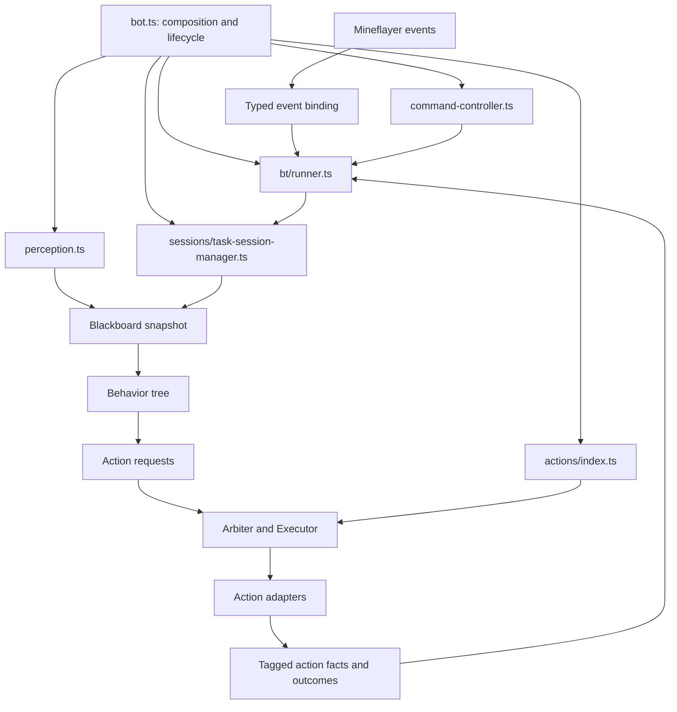
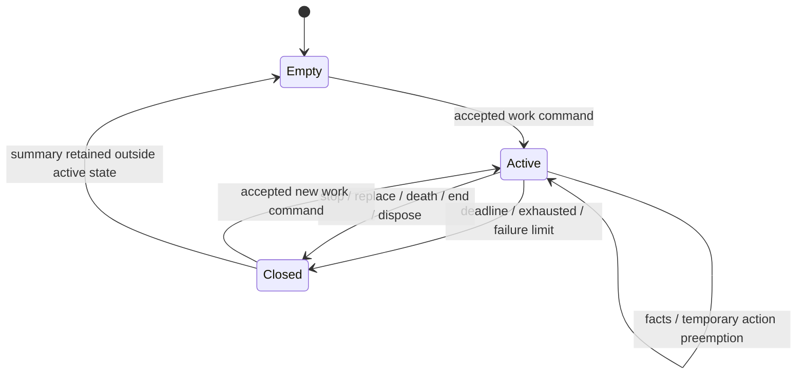

# System Design Proposal：Stage 2.4 Composition Root 與 Task Session Architecture

- **狀態**：Proposed；本文件尚未代表重構已實作。
- **日期**：2026-10-17
- **適用版本**：HEAD `662bd20e86fbe359a6bc75f1544fb688e64fecea` 與當下 Stage 2.4 工作目錄計畫。
- **問題證據**：[system-review-2026-10-17.md](../agent-note/system-review-2026-10-17.md)
- **對照文件**：[Stage 2.4 原計畫](../implement-plan-stage-2.md)、[Stage 1](../implement-plan-stage-1.md)、[系統設計 v1.1](system-design-v1.1.md)、[TypeScript 規範](../rules/rule-typescript-coding.md)、[測試規範](../rules/rule-testing.md)。
- **命名**：沿用目錄既有 `system-design-proposal-<topic>.md` 格式。

## 1. 建議決策

**保留 Perception → Blackboard → BT → Arbiter → Executor → Actions 的主架構；以任務身分、事件歸約、控制權與可清理資源為邊界重構。** `bot.ts` 的縮小是結果，不是成功定義。

原 Stage 2.4 的 Controller／Session／Registry 三個抽離方向合理，但還需要五項條件：

1. 任務有明確 taskId，與 executor runId/token/generation 分開。
2. duration、deadline、cooldown 共用單一 monotonic clock。
3. BT 只讀快照；完成、統計與持久化不在 BT callback 中執行。
4. cancel 的承諾是「不能再操作共享控制」，不是「本地 active=false」。
5. 所有 listener、patch、timer、I/O sink 有明確 owner 與 disposer。

這些條件直接對應健檢 SR-01～SR-16。僅把目前 callback 原封不動移到 `actions/index.ts`，會保留已確認的缺陷。

## 2. 方案比較與範圍

| 方案 | 作法 | 優點 | 代價／限制 | 建議 |
| --- | --- | --- | --- | --- |
| A：純抽檔 | 原邏輯搬進 controller、session、registry | diff 容易對照、短期風險低 | 時鐘、stale callback、BT finish 旗標、全域 patch 問題都在 | 可作局部遷移手段，不能作最終驗收 |
| B：小型 session reducer + 明確 ports | 保留既有引擎，補 task identity、clock、事件入口、disposer | 能直接處理已重現問題；可以分批交付 | 需修改 runner pipeline 與少量跨層型別 | **採用** |
| C：完整 actor/event-sourcing／DI framework | 每種任務獨立 actor、通用事件匯流排與持久事件庫 | 理論擴充性高 | 目前兩種工作任務不足以支持複雜度；增加除錯與遷移面 | 不採用 |

### 2.1 本次重構必須處理

- SR-01～SR-09 的時間、取消、組合、session、控制與清理契約。
- 指令前置條件、intent 更新、task replacement 的單一入口。
- FAULTED 的可見性、必要 session/run 關聯日誌。
- 既有 farming/hunting 已存在，必須納入完整組合測試，不能因計畫把完整 farming 排在 Stage 2.5 就忽略現有行為。

### 2.2 分開交付的相鄰改善

- 完整 logger 非同步 sink／rotation、持久化 schema 與寫入策略，可在 session 介面穩定後獨立提交。
- `navigation.ts` 的幾何與路徑共用重整、Perception 效能調校，先量測後另做。
- 不新增 LLM／Jev／Kev／Laya adapter，不實作 harvest、box、nightly sleep，也不新增通用 plugin framework。

## 3. 對原 Stage 2.4 的具體修訂

| 原規劃 | 評估 | 建議調整 |
| --- | --- | --- |
| TaskSessionManager 直接訂閱 Bot 事件 | 容易把 transport、domain state、presentation 混在一起 | Bot 事件在 composition 層轉成 plain facts；session factory 不持有 Bot |
| `complete()` 後 `reset()` | 分開呼叫可能漏 reset、重複 complete、覆蓋尚待呈現摘要 | 一次 terminal transition 同時封存摘要、撤銷當前 task 的寫入資格；重複 transition 回傳 null |
| Registry 封裝完成、持久化與業務轉移 | 會形成新的大型 callback 容器 | Registry 只組裝；domain result 交 session／runner，base/spawn result 交對應狀態 owner |
| `bot.ts` <180／<220 行 | 可讀性代理指標，兩個數字也不一致 | 以責任與依賴驗收；<220 是目標，不用壓行或隱藏複雜度達標 |
| `CompanionCore`、`enqueueCommandEvent` | 目前不存在 | 延用 `createRunner`／`enqueue`，必要時增加明確 `enqueueTaskEvent`，不造第二個 core |
| `createCompanionBot`、`GoToPoint` | 與目前 API／action 名稱不同 | 保留 `startBot`、`attachCompanion`、`ComeOnce`、`ReturnToBase` 的公開相容性 |
| `setInterval` tick | 目前用 `physicsTick`，fence 也依賴它 | 保留單一 physics scheduler；不要新增平行 decision timer |
| 「保證數據絕不丟失」 | 網路事件可能缺失、ID 重用、訊息 queue 有界 | 保證已接收且可歸屬的 facts 不跨任務污染；未知結果必須明示 |
| 全部測試通過即可驗收 | 現況已全通過但 probes 仍失敗 | 加入第 13 節的跨模組／負向測試與 Paper 驗收 |

## 4. 目標模組與依賴方向



依賴規則：BT 不 import action runtime、Bot 或 storage；session 不 import Bot、chat、executor；controller 不取得移動／攻擊能力；registry 不持有可變任務計數器。只用普通函式與閉包工廠，沿用現有風格。

### 4.1 第一階段檔案安排

```text
src/
  bot.ts                         # startBot / attachCompanion，組合及事件生命週期
  command-controller.ts          # validation、command routing、回覆格式
  commands.ts                    # 保留純 parser 與 owner 判斷
  sessions/
    task-session-manager.ts      # FARM/HUNT 狀態、facts、期限、terminal summary
  actions/
    index.ts                     # createActionAdapters，回傳 adapters 與 dispose
    navigation.ts                # 保留既有動作；修正 patch owner 與開門契約
    navigation-guard.ts          # 明確 run-scoped 控制授權
    farming.ts / hunting.ts      # 回報 tagged facts，不直接轉 intent
  bt/runner.ts                   # 有序事件歸約、快照、決策、reconcile
  blackboard.ts                  # task projection、runtime health 的唯讀資料
  execution/types.ts             # task metadata 與 outcome contracts
```

`Clock`、session types、controller ports 先與擁有它們的模組放一起；不要為每個 interface 建一個空泛檔案。事件綁定先保留在 `attachCompanion` 的具名 helper，若確實有獨立測試需求再抽 `bot-events.ts`。

### 4.2 模組 ownership

| Owner | 擁有的狀態／資源 | 不應擁有 |
| --- | --- | --- |
| Composition root | Bot connection、插件初始化、clock、dispose 順序 | 作物數、擊殺 Set、指令內容 switch |
| CommandController | parsed command 的驗證與 DTO、查詢輸出 | task counters、直接 control writes、直接改 runtime |
| TaskSession | 當前工作任務、attack evidence、plant evidence、failure streak、terminal summary | Bot listener、chat queue、資源鎖、檔案 I/O |
| Perception | 世界觀察、候選搜尋與短期觀察 cache | session 完成、直接 intent mutation |
| Runner | command/domain-event 順序、session transition 與 snapshot 邊界 | 具體挖放／戰鬥流程 |
| Executor | run/token/generation、資源操作生命週期、結果 | 工作期限、何時算 killed、命令訊息 |
| Action adapter | 單一 run 的控制、取消與停止確認 | 任務累計與直接結束其他任務 |
| Registry | 各 factory 與小型 capability ports 的 wiring | 跨 action 的可變業務狀態 |

Base/spawn 屬於跨 task 的位置狀態，不屬於 task session。初期可保留 Perception 現有位置 API，再獨立把 persistence 邊界整理為 `state-storage.ts` 的 typed 結果；不要為達成抽檔 KPI 同時大搬所有世界狀態。

## 5. 身分與時間契約

### 5.1 四種身分各司其職

| 身分 | 更新時機 | 用途 |
| --- | --- | --- |
| `generation` | death/end/dispose 等控制世代失效 | 阻擋前一個 Bot 生命週期 continuation |
| `taskId` | 每一個被採納的新 FARM/HUNT，包括重複同一命令 | 保護任務統計與完成語義 |
| `runId` | BT action 重啟、目標／能力契約改變、被搶佔後重建 | 單次 action 執行 |
| `token` | Executor 授予新 run lease | 實際共享控制權 |

目前 Blackboard 已有 `missionId`：**建議用它作 taskId 的值，不另養一個無關 counter**。同一 working intent 的 missionId 維持不變；修改 dig/bridge 只更動 intentRevision，不代表新 task。FARM/HUNT request 必須含 taskId（或等價 missionId），且納入 action signature，避免同目標的新任務沿用舊 run。

Session key 為 `(generation, taskId)`。Domain event 增加 `eventId`／來源序號做一次性處理；這是有限生命週期的去重資料，不是永久 event store。攻擊 action 在 start 時捕捉 key，不能在晚到 callback 發生時再讀「目前 session」來補上新 taskId。

### 5.2 時間

- Root 建立 `clock.now(): number`，正式預設 `performance.now()`，測試可注入從 0 開始的 fake clock。
- Runner snapshot、work startedAt/deadline、attack cooldown、perception cooldown、取消 deadline 使用同一 clock。
- `Date.now()`／ISO date 僅用於日誌與檔名；不存取持久化 monotonic timestamp。
- `clock.now() === 0` 合法，不能用 `now || Date.now()` 或 truthiness 判斷是否傳入時間。
- 「遊戲一天」目前依需求定義為 1,200,000ms elapsed time；與伺服器 time-of-day／TPS 並不相同。夜間作息應另讀遊戲時間，不改這個已定義的工作時長。
- 保留一個 physicsTick fence；有底層未停止操作時，另以 clock 量測真正 elapsed timeout。physicsTick 不來時，不得把 20 tick 說成已過 1 秒；若需要無 tick 的安全關閉，再增加單一生命周期 watchdog，不另跑 BT。

時間原點依據：[Node Performance API](https://nodejs.org/api/perf_hooks.html#performancenow)。

## 6. TaskSession 狀態模型

先只實作 FARM/HUNT；不設計通用工作流 DSL。以下是**介面草案**，不是可直接貼上取代現行 API 的完整實作。

```ts
type TaskKey = Readonly<{ generation: number; taskId: string }>;
type TaskKind = 'FARM' | 'HUNT';
type FinishReason =
  | 'COMPLETED'
  | 'TIMEOUT'
  | 'FAILURE_LIMIT'
  | 'USER_STOP'
  | 'REPLACED'
  | 'DEATH'
  | 'DISCONNECTED'
  | 'DISPOSED';

type TaskSummary = Readonly<{
  key: TaskKey;
  kind: TaskKind;
  reason: FinishReason;
  startedAt: number;
  endedAt: number;
  planted: number;
  observedDeathsAfterAttack: number;
  consecutiveFailures: number;
}>;
```

Session factory 提供 `start`、`applyFact`、`evaluate`、`finish`、`snapshot`。各方法只處理 plain data；例如 `finish(key, reason, now)` 僅在 key 仍活動時回傳 summary，重複或過期呼叫回傳 null。完成時先複製摘要、撤銷活動身分，再清 task-local sets；不先清零再產生訊息。

### 6.1 狀態轉移



Closed 表示領域任務不再接受統計，不代表底層 operation 已停止。Executor 仍負責 STOPPING／FAULTED 與資源移交；下一個工作可以先成為 pending intent，但衝突 action 不得越過控制停止確認。

不額外保存一個可變 `SUSPENDED` 布林值：Combat／Eat 搶佔時 task 仍 Active，是否被暫停可由 runtime 推導；開始時間不重設，deadline 持續計算。

### 6.2 觸發矩陣

| 事件 | Task 行為 | Intent／控制行為 |
| --- | --- | --- |
| 同 task 的 Combat/Eat 搶佔 | 保留 taskId、統計、deadline | 舊 run cancel，新 run 可在搶佔結束後恢復 |
| 新 `!hunt`／`!farm`，即使目標相同 | 舊 task REPLACED，新 taskId、計數歸零 | 先使舊 run 失效，再由下一輪取得新資源 |
| `!stop`／`!follow`／`!come`／`!return` 被接受 | 舊 task USER_STOP 或 REPLACED | 依原指令轉 STAY/FOLLOW/COME/RETURN |
| command 驗證失敗 | 不動 session | 原 intent 不變，回覆拒絕原因 |
| `!status`／`!item`／`!dig`／`!bridge` | 不重設 task | 設定只改能力；新 action 契約另依 revision 重建 |
| no target 且搜尋範圍可判定 exhausted | COMPLETED | 原地 IDLE |
| 目標在 cooldown／世界資料未知 | 保持 Active、等待下次 observation | 不宣稱工作完成，不每 tick 立即重試 |
| deadline | TIMEOUT，不受當前 BT 分支影響 | 工作 intent 原地 IDLE；必要生存動作可繼續 |
| death | 工作 task DEATH | generation 更新；建議 FARM/HUNT 轉 IDLE |
| end/dispose | DISCONNECTED／DISPOSED | 停止入口、取消 actions、清 queue、移除資源 |

**刻意的行為調整**：現況 death 保留全部 intent，但 hunting 統計被清空、farming 統計未一致清空。建議只保留既有可恢復的非工作導航 intent；工作任務死亡後結束，等待新命令。這不是抽檔自然帶來的行為，須與對應 lifecycle 測試一起明確落地。

## 7. 事件歸屬與每輪執行順序

### 7.1 事件分類

- **Latest-value**：world snapshot、重複 status request、同設定項目的最終值可以合併。
- **Ordered**：被接受的工作命令、任務停止／替換、attack/plant/failure/death facts、terminal outcome 不可用 `Map<event.type, event>` 覆蓋。
- **Immediate invalidation**：death/end/dispose 先同步撤銷 generation 與停止控制，不能排在一般 queue 後面等候。

Root 將 Bot 事件轉成 `{ eventId, generation, observedAt, entityId, ... }`；不要把 Mineflayer Entity／Item 實例放進事件。與 run 相關的 callback 另攜帶捕捉好的 taskKey/runId/token。原生死亡事件沒有 taskId，由目前活動 task 的 attack evidence 做關聯，不憑空補造攻擊者或最後一擊資料。

### 7.2 一輪流程

1. 以同一 clock 取得 `now`，切出當輪事件 batch；新到事件留待下一輪。
2. 依序處理 command／facts；valid command 才提交 intent 與 session start/replace。新 task 統計與 intent 在同一個同步邊界生效。
3. 消化 Executor outcome，驗證 generation/task/run；已收過的結果不重複計數。
4. 感知取得所需 observation；一次搜尋供本輪共用。快速健康／威脅更新不能等待慢工作掃描。
5. Session 依 facts、observation、in-flight operation 狀態與 deadline 產生 transition；必要時修改工作 intent、產生一次 summary。
6. 凍結 Blackboard world/intent/task/runtime，同一輪 BT 全部使用這份快照。
7. BT 回傳 ActionRequest，合併 Chat request，再由 Arbiter/Executor reconcile。
8. 記錄 transition 與 health telemetry；summary 交呈現層。Action start/update 同步回報的 facts 加入下一 batch，不能改當輪 snapshot。

高優先級生存搶佔不終止 task；明確工作命令才替換它。Domain reducer 的當輪工作必須有限；隊列建議初始上限 256、單輪處理 64 筆，數值集中配置並用負載測試調整。這些是初始設計值，不是已量測最佳值。

Overflow 不靜默丟掉已接受的工作結果：新 command 回覆 busy；domain facts 超量時將 health 設 degraded、停止新的工作 action 並記錄錯誤，轉入受控收尾。生存控制與 generation invalidation 仍優先可用；若資源停止無法確認，依第 9 節 fault 策略關閉。

### 7.3 命令順序與替換

Controller 的前置查詢只取需要的資料，例如 seeds、主人位置；以 command 接收時的座標錨定 rally。不得在 command callback 先清空 Session，再等 Runner 未來處理 intent。

同一批收到多個有效工作命令，按接收順序提交／替換，最後一個成為 active task；中間 task 可以被 REPLACED，但在 reconcile 前不啟動其 action。這是對現有單一 intent Map 的明確化；應用批次測試鎖定行為，避免每個模組各自「最後寫入贏」。

### 7.4 死亡證據與播種證據

- `recordAttack` 的證據保存 taskKey、entityId、觀察到的 entity identity、runId 與時間；在同 task 暫時搶佔期間仍可接受對應 death。
- `entityDead` 與 `entityGone` 分開；gone 只能解除 target retention。沒有 death 證據，不增加 killed 類統計。
- entity ID 重用時，比對當前 spawn identity（可用 entity UUID 或該世代的首次觀察序號）；不能只比較整數 ID。
- 來源無法辨別的晚到事件標為 uncorrelated，不能算到新 session。純 client 資料無法保證所有 kill attribution；不要使用「絕不遺失、絕對由 Bot 擊殺」的措辭。
- 播種使用 `(taskId, runId, operationId)` 去重；block type 必須符合 CROP_REGISTRY。`blockAt=null` 是 unknown，種子減少是輔助證據，不是無條件成功。
- 沒有候選目標但仍有待確認 planting operation 時，不立即 COMPLETED；在有界確認期限內保留 pending。確認逾期依 unknown/failure 政策結束該 operation，而非把 null 當成功。

Mineflayer 官方分別列出 death/gone 事件；本地 `entities.js` 也分別由 entity status 與 entity destroy 觸發。[Mineflayer API](https://github.com/PrismarineJS/mineflayer/blob/master/docs/api.md)

## 8. Controller 與 Registry 的具體介面原則

### 8.1 CommandController

輸入只有 owner/self identity、必要 read ports、`enqueueCommand`、`enqueueReply`、logger。保留 `parseCommand` 原有純函式與 `!fram` 等既有別名。

處理流程固定：ignore self → active check → parse/authorize → validate → 建立 command DTO → enqueue。查詢輸出集中小型 formatter；不要把裝備 slot index 散落在 root，也不要讓 formatter 每次觸發完整世界掃描。

拒絕不改狀態；成功 enqueue 不等於執行完成。訊息應區分 accepted／completed／failed。`!status` 增加 taskId、deadline remaining、執行 health、fault reason、STOPPING/FAULTED runs，不能只顯示 RUNNING 與 Idle。

### 8.2 ActionRegistry

`createActionAdapters(deps)` 回傳：

- `adapters`：現有 AdapterRegistry，仍支援測試的 overrides。
- `dispose()`：只處理 registry 擁有的 wrapper／listener／adapter 工廠資源。

`deps` 明列 navigation/combat/inventory/farming 所需的 ports、clock、logger、`publishFact`。不要傳入可任意讀寫的整個 application object；不要引入 DI container 或以 string 動態發現插件。

成功、失敗與到達等 callback 改為 tagged outcome。`ComeOnce` 的結果帶 missionId，只有還是同一 mission 才轉 STAY；舊的 arrival/failure 不得蓋掉新 `!follow`。Spawn 的持久化交位置狀態 owner，並回報是否真的確認成功。

## 9. 控制能力與取消契約

### 9.1 兩層安全性必須同時成立

1. **應用層**：每次 await 的 resolve/reject/fallback，以及下一次控制寫入前檢查 ctx；事件回呼亦檢查所屬 generation/run/task。
2. **插件層**：確認呼叫出去的方法會不會在內部 await 後繼續送封包。外層 token 無法取消已進入 Mineflayer 的 continuation。

例如已安裝 Mineflayer 的 `activateBlock()` 在內部 await `lookAt()` 後才送 `block_place`。其 Promise 尚未完成時，`DoorManager.reset()` 把 inFlight 設 false 並不能代表它安全停止。

### 9.2 停止策略

| 情況 | 移交規則 |
| --- | --- |
| 已同步停止所有控制、只剩結果 Promise | 一個 physicsTick fence 後可移交；不等待無副作用 Promise |
| 有可取消的底層控制 | 先執行真正 cancel，確認無後續控制能力後移交 |
| 不可取消且仍可能操作的底層 Promise | 不阻塞 decision loop；保留衝突 lease，等待 bounded drain |
| drain 逾時／取消 throw | 標 FAULTED，拒絕不安全交接，記錄原因並由 lifecycle 受控斷線 |

保留現有 1000ms 停止確認上限作初始策略，但以 monotonic clock 量測並列入 config。這是取捨：無法停止的操作可能延遲緊急反應；真正解法是讓控制邊界更可取消，而不是假釋放鎖。`!stop` 可以提出終止任務，但不能證明故障插件安全後才允許解鎖。

`isStopped()` 必須測真實狀態；禁止「cancel 清 inFlight → isStopped 立即 true」循環自證。對 in-flight count 使用 operation 身分，避免舊 finally 清掉新 run 的旗標。

### 9.3 解決全域 placeBlock 衝突

短期保留 navigation 防護，但建立明確能力入口：

- Navigation 的 dig/place 只接受 navigation run context、白名單與 quota。
- Farming 使用獨立受控 plant port；捕捉原始 API，驗證 FARM run 的資源與 crop/target，並追蹤其 operation drain。
- 全域未知 dig/place 呼叫仍拒絕；不能用「無 context」作 bypass。
- 安裝與還原 wrapper 集中在 root 擁有的 adapter boundary；只裝一次，保留 owner 標記，dispose 不覆蓋其他來源的新方法。

這不需要重做完整 Mineflayer facade。先包已有真實跨 action 衝突的 dig/place/activate 操作；每加一個入口都要有對應安全契約測試。

### 9.4 開門資源

普通導航維持 MOVE/LOOK，可與 Eat 並行；**它不能自行 `activateBlock`**。遇到關門時，產生門位置 observation，下一輪請求一個具有 MOVE/LOOK/HAND 的門互動 run；依既有 priority 與原子資源配置等待。

門互動是修正既有開門功能，不是新增泛用工作流。第一版不用動態升鎖、不暫借 HAND；Eat 尚持有 HAND 時就暫停門互動。已取得完整手部資源的導航也必須走同一受控操作契約，避免留下隱性旁路。

## 10. Lifecycle 與 dispose

保留 `startBot`／`attachCompanion` 公開 API、`options.adapters`、`options.now`、`options.logger`、`storagePath`。`options.now` 在內部轉成共用 Clock，確保測試既有入口可延用。

### 10.1 啟動順序

1. 驗證 env；建立 clock、logger、位置狀態。
2. 建立 Bot、載入 pathfinder；建立能力 ports 及可還原 patch。
3. 建立 Blackboard、Perception、Session、Arbiter／Executor、BT、Runner。
4. 建立 Controller，綁定具名事件 handlers。
5. spawn 後完成 movement setup，再啟用 runner；constructor 不先執行任務。

Root 可以用小型 forwarder 連接 registry 的 `publishFact` 到 Runner，前提是 start 前完成接線且禁止 constructor 發 facts。避免靠大量引用尚未宣告變數的 callbacks 隱藏初始化順序。

### 10.2 停止順序

1. 標記 inactive/disposed，拒絕新 commands/domain callbacks。
2. 失效 generation，暫停 runner，停止／撤銷所有 active runs。
3. 封存或丟棄本次工作摘要（依 death/end/dispose 原因）；清未處理事件，不讓舊 facts 帶到下一世代。
4. 解除 root 與 adapter 所有訂閱、timer；對仍在 drain 的操作保留必要安全 guard。
5. 在確定 operation 不會再控制後恢復自己安裝的 wrapper；若不能確認，走受控斷線，不能宣稱 Bot 已可安全重新 attach。
6. flush/close 自己擁有的 logger sink；外部傳入 logger 由呼叫者持有，不擅自關閉。

dispose 冪等；attach 同一個仍在 active/draining 狀態的 Bot 應明確拒絕，不堆疊 wrapper。可保留同步 `dispose()` 作立即失效與清理入口，另外提供可等待的 `closed` Promise 確認 drain/flush；API 變更以 additive 方式遷移。

**reset 與 dispose 不同**：respawn 可以保留可重用插件與事件綁定，但需全新控制世代；dispose 則解除整個 attachment。死亡後是否保留導航 intent 與工作 task 的政策見第 6 節，不靠散落 reset 呼叫決定。

## 11. 可觀察性與效能策略

### 11.1 最小必要 telemetry

每筆生命週期事件具備 `botId`、`generation`、`taskId`（有時才填）、`runId`、`actionType`、`reason`。控制移交事件再帶 token/resources；普通文字 chat 不必每筆完整輸出內容。

事件至少包括：`task_started`、`task_finished`、`task_replaced`、`action_started`、`action_stop_requested`、`action_stopped`、`action_failed`、`runtime_faulted`、`stale_fact_dropped`、`chat_dropped`、`state_write_failed`。

保存可查的 runtime health：`ready | stopping | degraded | faulted | closed`。`!status` 可從 session terminal summary 看到上次任務結果，即使當時 chat enqueue 失敗。

Session transition 與「產生 summary」可保證一次；Chat transport 沒有 ack 時不承諾 exactly-once delivery。queue full 時優先保留完成／錯誤訊息，取代或合併重複 status；仍失敗就記錄 dropped counter，不把 task rollback 成 Active。

### 11.2 量測再優化

- 記錄 `sample_ms`、`decision_ms`、`reconcile_ms`、`cancel_to_stopped_ms`，以及 action failure/timeout、queue length、cooldown map size。
- 可用 Node 既有 `perf_hooks` 監測 event-loop delay；不必先導入 metrics server。
- 純 BT 的提案驗收目標為代表性負載下 p95 <1.5ms；完整同步一輪目標 p95 <10ms。**這是待量測目標，非目前成績或對所有硬體的保證。** 記錄 CPU、Node、entity 數與搜尋範圍後才比較。
- 工作搜尋一次一輪共用；可先用 250–500ms 的 bounded refresh 做實驗，受傷與生存觀察仍即時。unknown/cooldown 不能為了降低掃描頻率而誤報完成。
- Clone/freeze 先保留正確性，量測後再減少多餘複製；小型 Arbiter 不引入 heap。
- `navigation.ts` 後續可抽幾何 helper、pathfinder patch installer、靜態目的地共用流程；不要用繼承樹統一所有 follow/combat/retreat。

## 12. 分批遷移與回退方式

每一批都維持可 build、可 test；先加反映缺陷的測試再修正。純搬移與語義修正盡量不同提交，便於 bisect。以下是依賴順序，不是時間承諾。

| 批次 | 修改範圍 | 對應問題 | 交付門檻 |
| --- | --- | --- | --- |
| 2.4-A 契約基線 | 新增少量 clock、取消、完整 registry 組合、連續任務回歸測試 | SR-01～04 | 先證實會失敗，不把現有錯誤行為寫成永久 expected |
| 2.4-B clock 與控制安全 | root clock wiring、farm fallback fence、dig/place 能力隔離、開門 HAND | SR-01～03、06 | 未持 lease 的操作為 0；晚到 continuation 不可送控制 |
| 2.4-C session state | 新 TaskSession factory、taskKey、facts、summary | SR-04、07 | 連續任務／去重／替換／暫停與死亡矩陣通過 |
| 2.4-D runner/BT 邊界 | 有序 facts、task projection、純 BT、deadline 不受分支遮蔽 | SR-08 | snapshot 重播、mid-tick event、期限／unknown 情境通過 |
| 2.4-E controller/registry/root | 抽指令、factory wiring、disposer，修正傷害來源策略 | SR-05、09、14 | 原指令對照、patch 還原、重複 attach/dispose、零新增 any |
| 2.4-F 健康與實機驗收 | fault telemetry、任務摘要可查、必要文件修訂 | SR-11、13、16 | 靜態檢查與完整測試、Paper 場景、soak 記錄 |
| 後續獨立改善 | state-storage、logger sink、perception/profile、導航去重 | SR-10、12～16 | 依各自故障注入與量測結果驗收 |

B 批次開門互動所需的最小 observation/request 欄位可先加入現有 snapshot；D 批次再統整完整 work observation，避免因里程碑命名限制必要依賴。尚未安全隔離的控制路徑，不得為了先抽 controller 而宣布完成。

回退採逐提交 revert；不維護雙份 session manager、雙套 scheduler 或長期 feature flag。若新 session 路徑未通過，停在前一個安全批次；已修正的 clock／stale operation 不因純抽檔回退而恢復缺陷。

## 13. 驗收矩陣

| 類別 | 必測情境 | 可觀察的不變式 |
| --- | --- | --- |
| Clock | 預設 wiring、fake clock 從 0、期限前後、wall clock 跳動 | 所有 elapsed 比較同一原點；FARM/HUNT 20 分鐘結束 |
| Session | FARM→FARM、HUNT→HUNT、FARM→HUNT、三次連續完成 | 新 taskId；統計不串；每次只有一個 terminal summary |
| Replacement | 同一 target 的新工作命令、完成事件與新命令同 batch | 舊 run/task 不能改新 intent／統計 |
| Preemption | work→Combat/Eat→work；搶佔期間收到 death fact | taskId 與期限保留，runId 更新，合法死亡只算一次 |
| Lifecycle | death/respawn/end/dispose；dispose 兩次；draining 時再 attach | 舊 generation 無效、無 listener/patch 疊加、工作死亡政策明確 |
| Async safety | 每個 await resolve/reject 前取消；插件內部 await 後送操作 | 無 stale control writes；不可停止時不交接衝突 lease |
| Complete wiring | navigation wrapper + 真實 farming factory | 合法播種可進原始 API，非法挖放拒絕，fallback 不跨取消 |
| Door resources | Follow+Eat、Retreat+Eat、門互動被取消 | 任何開門操作都有 HAND/LOOK 授權與停止確認 |
| Hunting facts | attacked+gone、unattacked+dead、dead+gone、ID 重用 | 消失不算死亡、去重、不猜新任務歸屬 |
| Plant evidence | 成功作物、錯誤方塊、null block、種子變動、pending operation | unknown 不等於成功；不提前完成任務 |
| Damage source | 環境傷害、旁觀玩家、過期 swing、可靠來源 | 無依據不建立玩家 threat；保留 hostile 防禦 |
| BT purity | 同一 snapshot 的重播、所有分支遮蔽 work | 沒有 live-world callback、副作用；deadline 仍處理 |
| Failure | cancel throw、drain timeout、fault status、chat full | fail-closed 且可診斷；無假成功或無聲重啟 |
| Storage（後續） | 無檔、損壞 JSON、非有限座標、寫入拒絕、中斷寫入 | 不回傳 NaN、不假稱已持久化、保護舊檔 |
| Long run | 重複任務、entity churn、100 次 attach/dispose | listener/method identity 回基準；maps 有界、無單調 heap 增長 |

每批執行 `pnpm run typecheck`、`pnpm test`、`pnpm run lint`、`pnpm run format:check`。Paper 驗收需記錄 Mineflayer/pathfinder/伺服器版本與實際案例，至少涵蓋：播種中戰鬥搶佔、打過動物消失、門前吃飯、取消後再派相同工作、死亡重生，以及超過 20 分鐘的工作期限。原 Paper E2E 的 follow/unfollow/status 不足以替代以上驗證。

## 14. 必須同步的文件與完成定義

實作採納後，在同批修訂：

- Stage 2.4：改用真實 API 名稱、單一 physics scheduler、task identity／事件順序驗收；移除以行數證明穩定性的說法。
- TypeScript RULE-05／動態 canDig 規則：區分 control-plane 已停止與 plugin 仍有副作用；明訂整組固定資源契約。
- Stage 2 通則：工作完成原地 IDLE；死亡工作任務如何結束；unknown/cooldown 的等待政策。
- 系統設計：加入 task projection、health、facts/outcomes 與 ownership；保留過往 ADR 歷史，新增針對本次被接受決策的 ADR。

**Stage 2.4 完成時，新增工作行為不需要修改 root 的任務計數邏輯；任何結果都可回答「屬於哪個 task/run、是否仍有效、誰持有控制權、如何停止與清理」。** `bot.ts` 應能讀出組合與生命週期，既有引擎保留，且第 13 節的不變式有實際驗證結果。這才是可維護與穩定性改善的證據。

---

## 15. 面向未來 `Jev/Kev + Small LLM Tool-Call` 架構之無縫銜接設計

為了避免在 Stage 2 完成後進入 Stage 3（以 `Jev + Small LLM Tool-Call` 取代行為樹，詳見 [system-design-proposal-llm-kev.md](system-design-proposal-llm-kev.md)）時發生二次重構，Stage 2.4 抽離出的三大核心模組在介面設計上直接對齊未來 AI 管線的需求（符合 **YAGNI** 原則：不預寫未使用的 AI 推理邏輯，但確保當前介面契約即為未來 AI 所需的形狀）：

### 15.1 三大重構模組在當前 Stage 2 與未來 AI 架構的雙重角色

| Stage 2.4 重構模組 | 在 Stage 2 (BT 架構) 的職責 | 在 Stage 3 (`Jev + Small LLM Tool-Call` 架構) 的直接轉化角色 |
| :--- | :--- | :--- |
| **`ActionRegistry`**<br>(`src/actions/index.ts`) | 統一組裝各領域 Action Factory，隔離 `bot.ts` 與底層回呼，管理 `dispose()` 與 `dig/place` 安全邊界。 | **Tool Registry & Jev Stage 4 Precondition Guard**：<br>每個註冊的 Action 具備明確的參數規格與 `validatePreconditions(snapshot, params)`，直接供小模型進行 Tool Calling (`action1(args) + action2(args)`)，並供 Jev 在執行前驗證行動是否成立。 |
| **`TaskSessionManager`**<br>(`src/sessions/task-session-manager.ts`) | 以 `(generation, taskId)` 聚合跨 Tick 領域事實（播種數、擊殺證據、失敗熔斷、工時期限），取代 `bot.ts` 閉包變數與 `work.ts` 旗標。 | **Multi-Step Task Tracker & RL Reward Aggregator**：<br>1. 為小模型拆解出的多步任務佇列提供每個 Step 的完成/失敗轉移判定。<br>2. 自動輸出每個 `taskId` 期間的客觀統計（`planted`, `observedDeaths`, `failures`, `deltaHP`），直接作為 Kev/Laya 強化學習（RLCD / GRPO）的 Reward 訊號來源。 |
| **`CommandController`**<br>(`src/command-controller.ts`) | 解析 `!hunt`、`!farm`、`!item` 等聊天指令，執行前置檢查並送出有序的 Command/Intent 事件。 | **Jev Gatekeeper & Planner 入口**：<br>保留 `!cmd` 零延遲快速通道；當收到自然語言或複合任務時，在此層交由 `Jev 識別路由 -> 小模型 Tool-Call 分拆`，最終送入相同的 `Runner` 有序事件佇列。 |

### 15.2 關鍵介面預對齊：Action Descriptor 契約 (`SR-17` 解法)

在實作 `src/actions/index.ts` 時，除了回傳給 `Executor` 的 `AdapterFactory` 外，建議為每個動作提供輕量的純函式前置驗證（不增加外部依賴，且立即解決目前前置驗證散落在 `bot.ts` 與 `work.ts` 的問題）：

```ts
export interface ActionDescriptor<P extends Record<string, unknown> = Record<string, unknown>> {
  readonly actionType: ActionType;
  readonly requiredResources: readonly ResourceChannel[];
  // 供 CommandController (現在) 與 Jev 階段四行動成立辨別 (未來) 共用的純函式檢查
  validatePreconditions?(snapshot: BlackboardSnapshot, params: P): {
    readonly ok: boolean;
    readonly reason?: string;
  };
  createAdapter: AdapterFactory;
}
```

### 15.3 為什麼必須「先做 Stage 2.4 重構，再開發 Stage 2.5~2.8 剩餘功能」？

1. **避免在壞掉的底座上複製 Bug**：
   - 現有 `SR-01`（`performance.now()` 與 `Date.now()` 混用導致 20 分鐘工時失效）、`SR-03`（`NavigationExecutionBoundary` 全域攔截 `bot.dig` / `bot.placeBlock`）與 `SR-04`（`work.ts` 閉包完成旗標在第二次任務卡死）若不先在 Stage 2.4 修好，接下來開發 **Stage 2.6 `!harvest`（需呼叫 `bot.dig` 挖作物）** 與 **Stage 2.8 `!box`** 時會直接踩中相同陷阱。
2. **讓後續 Stage 2.5~2.8 開發變成「純增量插拔」**：
   - 先完成 Stage 2.4 後，`bot.ts` 已退化為薄組裝根（Thin Composition Root）。
   - 接著開發 `!harvest`、`SleepAtBed`、`!box` 時，每個新功能只需：
     1. 新增對應的 `src/actions/<feature>.ts`（包含 `validatePreconditions` 與 `createAdapter`）；
     2. 在 `ActionRegistry` 註冊；
     3. 在 `TaskSessionManager` / `CommandController` 補上對應分支。
   - **不僅 Stage 2 剩餘功能開發速度更快、測試更乾淨，且寫完的那一刻，所有新動作都已經自動具備未來給 `Jev + 小模型 Tool-Call` 呼叫的標準結構。**

