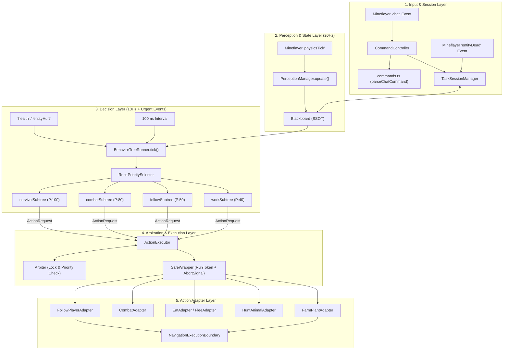
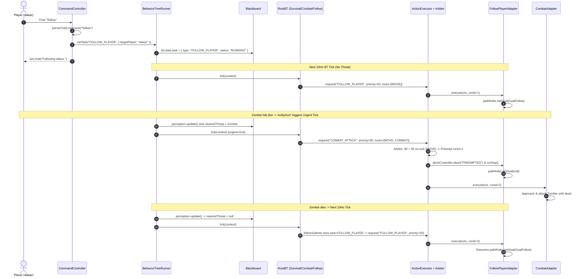
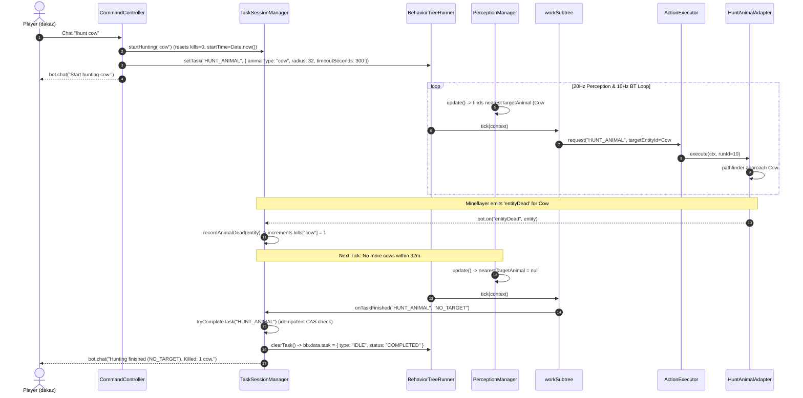
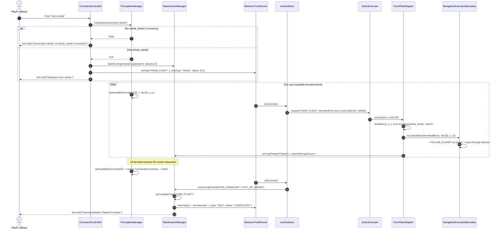

# System Design v1.2 — Pre-LLM Clean Architecture & Module Coordination

- **Status**: Approved Baseline (Stage 3 & Stage 4 Target Architecture)
- **Scope**: Complete `src/` directory layout, module responsibilities, runtime tick coordination, and 3 end-to-end task execution walkthroughs prior to introducing `Jev/Kev` or Small LLM planners.
- **Design Principles**: KISS, YAGNI, Single Clock Source (`Date.now()`), Stateless BT Factories, and Explicit Composition Root (`src/bot.ts < 220` lines).

---

## 1. Directory & Module Structure (`src/`)

```text
src/
├── bot.ts                          # Composition Root (< 220 lines): lifecycle, event binding, tick scheduling
├── command-controller.ts           # Chat command routing, validation, and user feedback replies
├── commands.ts                     # Pure command parser (parseChatCommand) and whitelist validation
├── blackboard.ts                   # Single Source of Truth (SSOT) for bot state, threats, and active TaskState
├── perception.ts                   # World sensor aggregation (entities, blocks, inventory, farmland scan)
├── policy.ts                       # Strategy selection (weapon/food scoring, tactical parameters)
├── logger.ts                       # Structured JSONL telemetry logger (tick, trace, event, error)
├── types.ts                        # Shared domain interfaces and type contracts
│
├── sessions/
│   └── task-session-manager.ts     # Stateful session counters, async kill aggregation, and idempotent task completion
│
├── config/
│   ├── schema.ts                   # Zod configuration schema and defaults
│   └── loader.ts                   # Runtime config loader & hot-reload watcher (configs/bot-config.json)
│
├── bt/                             # Stateless Behavior Tree Decision Layer (10Hz / Event-Urgent)
│   ├── types.ts                    # BTNode, BTContext, BTTickResult contracts
│   ├── nodes.ts                    # Core composite nodes (PrioritySelector, Sequence, Condition, Action)
│   ├── tree.ts                     # Root priority tree assembly (Survival -> Combat ->Follow/Work -> Idle)
│   ├── runner.ts                   # BehaviorTreeRunner: drives BT ticks, routes intent to Arbiter & Executor
│   └── subtrees/
│       ├── survival.ts             # Eat / Flee emergency subtree
│       ├── combat.ts               # Self-defense melee/retaliation subtree
│       ├── follow.ts               # Follow target player subtree
│       └── work.ts                 # Stateless task subtree (HUNT_ANIMAL, FARM_PLANT, HARVEST_CROP, DEPOSIT_ITEMS)
│
├── execution/                      # Resource Arbitration, Preemption & RunToken Lifecycle
│   ├── types.ts                    # ResourceLock (MOVE, COMBAT, USE_ITEM, HAND, CONTAINER), ActionContract
│   ├── arbiter.ts                  # Priority & preemption matrix evaluation
│   ├── wrappers.ts                 # SafeWrapper (RunToken generation, timeout guard, AbortSignal propagation)
│   └── executor.ts                 # ActionExecutor: manages active runs, preempts conflicting locks, cleans up
│
└── actions/                        # Concrete Mineflayer Action Adapters
    ├── index.ts                    # registerAllActions(): wires all ActionAdapters into ActionExecutor
    ├── navigation.ts               # FollowPlayerAdapter, NavigationExecutionBoundary, pathfinder config
    ├── survival.ts                 # EatAdapter, FleeAdapter
    ├── combat.ts                   # CombatAdapter (target lock, approach, attack cadence)
    ├── hunting.ts                  # HuntAnimalAdapter (approach & attack passive animal)
    └── farming.ts                  # FarmPlantAdapter (equip seed, approach farmland, placeBlock)
```

---

## 2. Module Responsibilities & Coordination Overview

### 2.1 Layer Separation

| Layer | Modules | Execution Cadence | Core Responsibility |
| :--- | :--- | :--- | :--- |
| **1. Input & Session Layer** | `command-controller.ts`, `commands.ts`, `task-session-manager.ts` | Event-driven (`chat`, `entityDead`) | Parses player commands, initializes session metrics (`TaskSessionManager`), sets `Runner.setTask()`, and guarantees idempotent completion (`tryCompleteTask`). |
| **2. Perception & State Layer** | `perception.ts`, `blackboard.ts`, `policy.ts` | 20Hz (`physicsTick` -> `perception.update`) | Samples Mineflayer `bot.entities`, `bot.inventory`, and nearby blocks into `BlackboardData` using a unified `Date.now()` clock. |
| **3. Decision Layer (BT)** | `bt/runner.ts`, `bt/tree.ts`, `bt/subtrees/*` | 10Hz (`100ms` timer) + Urgent Events (`health`, `entityHurt`) | Reads `BlackboardData`, evaluates priority subtrees (`SURVIVAL > COMBAT > WORK/FOLLOW > IDLE`), and outputs a desired `ActionRequest` without performing side effects directly. |
| **4. Arbitration & Execution Layer** | `execution/arbiter.ts`, `execution/executor.ts`, `execution/wrappers.ts` | Per BT tick / Action promise lifecycle | Checks `ResourceLock` conflicts (`MOVE`, `COMBAT`, `USE_ITEM`, `HAND`, `CONTAINER`), preempts lower-priority actions via `AbortController`, and isolates stale callbacks via `RunToken`. |
| **5. Action Adapter Layer** | `actions/navigation.ts`, `actions/combat.ts`, `actions/survival.ts`, `actions/hunting.ts`, `actions/farming.ts` | Async Mineflayer operations | Translates abstract `ActionRequest` payloads into concrete Mineflayer / `mineflayer-pathfinder` API calls while honoring `ctx.isActive()` and `ctx.signal`. |

### 2.2 System Coordination Architecture Diagram



---

## 3. End-to-End Task Walkthroughs

### Walkthrough 1: `!follow` with Mid-Way `Combat` Preemption & Automatic Resume

- **Scenario**: Master `dakaz` issues `!follow`. While the bot is pathfinding toward `dakaz`, a hostile zombie attacks the bot (`entityHurt`). The bot immediately preempts `FOLLOW_PLAYER` to fight the zombie (`COMBAT_ATTACK`), kills it, and automatically resumes following `dakaz`.
- **Key Mechanism**: `FOLLOW_PLAYER` (priority `50`, locks `['MOVE']`) is preempted by `COMBAT_ATTACK` (priority `80`, locks `['MOVE', 'COMBAT']`). Importantly, `bb.data.task` remains `{ type: 'FOLLOW_PLAYER', status: 'RUNNING' }` in the `Blackboard`, so once `bb.data.nearestThreat` clears, the BT naturally falls back to `followSubtree`.



---

### Walkthrough 2: `!hunt cow` Area Task & Asynchronous Death Event Aggregation

- **Scenario**: Master `dakaz` issues `!hunt cow`. The bot scans for nearby cows, hunts them one by one within the `300s` timeout, aggregates drops/kill counts asynchronously via `entityDead`, and transitions to `IDLE` when no cows remain in range.
- **Key Mechanism**: `workSubtree` stays 100% stateless. All kill counting (`recordAnimalDead`) and single-fire completion (`tryCompleteTask`) are owned by `TaskSessionManager` so subsequent `!hunt` commands never suffer from stale closure flags.



---

### Walkthrough 3: `!farm wheat` Seed Validation, Farmland Scan & Non-Blocking Block Placement

- **Scenario**: Master `dakaz` issues `!farm wheat`. The bot validates inventory seeds up front, locates empty farmland (`farmland` with `air` above), walks to it, equips `wheat_seeds`, and calls `bot.placeBlock()`.
- **Key Mechanism**:
  1. `NavigationExecutionBoundary` only guards dig/place calls initiated by `FOLLOW_PLAYER`'s `Pathfinder`, allowing `FarmPlantAdapter.placeBlock()` to execute directly (`[RULE-11]`).
  2. `TaskSessionManager` tracks `plantedCropsCount` and `consecutiveFailures` (circuit breaker after 3 consecutive failures) and uses `tryCompleteTask('FARM_PLANT')` to ensure multi-round `!farm` commands work reliably.


